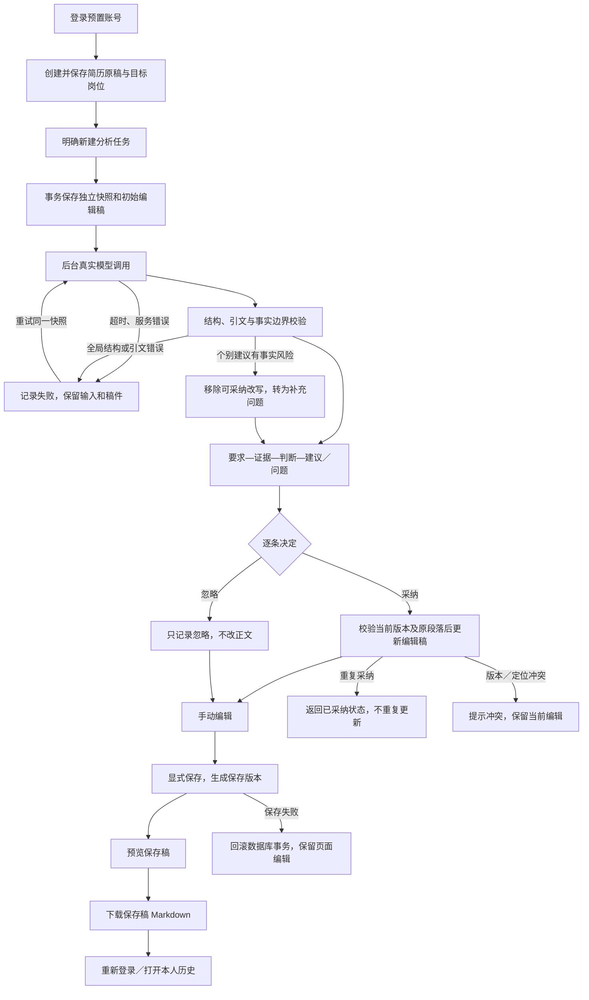
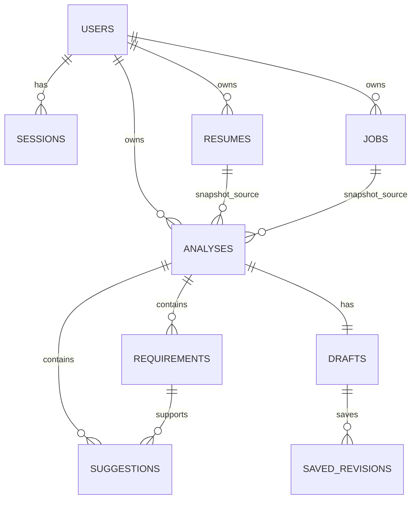
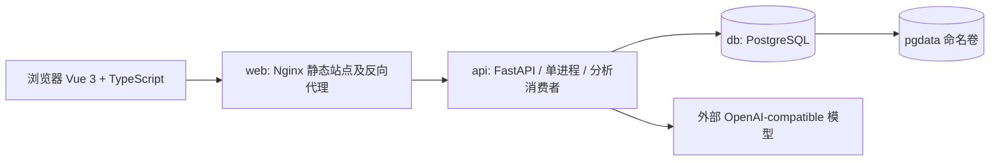

# 简历与岗位匹配助手：开发前技术设计

状态：设计基线 v1；尚未搭建业务代码。本文的“完成标准”“通过条件”均是待执行的验证要求，不是已通过结果。

## 0. 阅读范围与设计决策

已完整阅读目录中的《开发与验收清单.md》（含六份清单）及官方附件 README.md、comparison-guide.md、index.html、evidence-comparison.csv、version-checklist.csv、test-cases.csv、SHA256SUMS；原始题目以用户提供正文及此前 exam_status 返回题目为准。目录当前没有独立的原始题目文件，不声称读到了不存在的文件。

需求编号沿用功能 F01～F18、验收 A01～A16、权限 P01～P10、异常 E01～E16、交付 D01～D13。附件 RES-01～09、VER-01～08 保留原编号。

确定采用 Vue 3 + TypeScript、FastAPI + Pydantic、SQLAlchemy + Alembic、PostgreSQL、Docker Compose，后端通过 OpenAI-compatible Chat Completions 接口调用模型。前端只做流程所需的页面与状态，不在本阶段美化。

关键决策：

1. 创建的简历原稿不可被改写操作修改。编辑正文发生在分析任务的编辑稿中；需要新的原始输入时新建简历。
2. 每个分析任务独立保存简历／岗位快照，并拥有一份编辑稿和自己的保存版本。新分析不会写入旧任务编辑稿。
3. 采纳更新编辑稿；显式保存才创建保存版本；预览与导出只读取保存版本。
4. 不使用自由文本替换来自动接纳所有模型改写。来源校验、约束改写和风险拦截在建议可采纳前完成。
5. PostgreSQL 同时保存业务数据和待执行任务。第一版单 API 进程、单分析消费者，不引入 Redis／Celery。
6. 不增加注册、文件解析、评分、PDF、复杂角色、版本回滚界面等范围外功能。

## 1. 核心业务流程及异常分支



所有业务节点均经过后端身份和所有权校验：无会话返回 401；资源不存在或非本人资源统一返回 404；并不会因知道 ID 而跳过归属检查。

### 1.1 分步骤约定

| 步骤 | 输入和处理 | 结果／异常 |
|---|---|---|
| 登录 | 登录名和密码；校验密码哈希；建立服务端会话 | 错误返回统一提示；不创建会话；退出撤销会话。 |
| 创建输入 | 简历标题／正文、岗位名／描述；后端校验空白和长度 | 返回保存记录；前端失败保留输入。简历文本原样保存，不改写、不隐式修剪正文。 |
| 新建分析 | 选择本人 resume_id、job_id；请求提供幂等键 | 同一事务复制快照、创建任务及编辑稿，返回 202。重复键返回原任务；不同键才是新分析。 |
| 分析进行中 | 前端轮询详情，展示 queued／running；正文仍可查看 | 请求超时／认证错误／限流／网络失败均记为失败；不用固定报告兜底。 |
| 查看结果 | 展示岗位原文、证据或空值、三种判断、原因、建议和问题 | 有效判断无安全改写时仍可查看证据与补充问题，明确“无可采纳改写”。 |
| 采纳 | 上传当前编辑内容和编辑版本；服务端按存储的安全建议替换精确段落 | 幂等、原稿不变；定位冲突返回 409；不追加到末尾、不全局替换。 |
| 忽略 | 记录状态；不修改正文 | 已采纳建议不允许通过“忽略”隐式撤销，返回 409；用户可手动编辑。 |
| 手工编辑 | 前端更新文本与 dirty 状态 | 不自动请求模型；用户自行补充的新信息不冒充模型从原稿提取的事实。 |
| 显式保存 | body_markdown + expected_edit_version | 原子更新编辑稿、插入保存版本；失败回滚且保留本地文本；并发冲突不静默覆盖。 |
| 预览／导出 | 选定该任务已保存版本；显示版本号 | 未保存过返回 409；有未保存编辑时提示“预览／导出为保存版本，当前编辑尚未保存”。 |
| 再次分析 | 明确新任务，选择保存的另一岗位或新建简历 | 永远不重用旧任务的编辑稿；失败重试只针对失败任务的原快照。 |

先保存、再分析使用原稿；第一版不实现“以当前修改稿自动重新分析”。若需要分析修改后的内容，用户明确创建新简历，并以该记录创建新任务。

## 2. 数据模型

### 2.1 实体及主要字段

ID 使用 UUID；时间保存为 UTC timestamptz，前端按用户时区展示。正文使用 text，不把模型说明塞进正文。

| 实体 | 主要字段 | 状态／约束 |
|---|---|---|
| users | id、username、password_hash、created_at | username UNIQUE；至少两个预置账号；无注册接口。 |
| sessions | id、token_hash、user_id、csrf_token_hash、expires_at、revoked_at | 仅保存随机会话令牌的哈希；会话过期／撤销后不可用。 |
| resumes | id、owner_id、title、original_text、created_at | 正文创建后不可更新；仅允许修改标题；UNIQUE(id, owner_id) 供复合外键使用。 |
| jobs | id、owner_id、name、description、version、created_at、updated_at | 可显式更新；version 防止并行覆盖；UNIQUE(id, owner_id)。 |
| analyses | id、owner_id、resume_id、job_id、resume_snapshot、job_name_snapshot、job_description_snapshot、resume_segments JSONB、state、attempt_no、request_key、request_fingerprint、lease_until、error_code、error_message、warnings JSONB、model_metadata JSONB、prompt_version、validator_version、created_at、started_at、finished_at | state 为 queued/running/succeeded/failed；UNIQUE(owner_id, request_key)；快照一经创建不可更新。 |
| requirements | id、analysis_id、ordinal、job_quote、job_span JSONB、resume_quote nullable、resume_span nullable、match_status、reason、confirmation_questions JSONB | match_status 为 reflected/not_reflected/needs_confirmation；UNIQUE(analysis_id, ordinal)；证据无则 NULL。 |
| suggestions | id、analysis_id、requirement_id、source_segment_id、original_text、suggested_text nullable、rewrite_reason、template_id nullable、template_args JSONB、validation_status、blocked_reason nullable、decision、decided_at | validation_status 为 actionable/blocked；decision 为 pending/accepted/ignored；不可修改模型建议正文；只有 actionable 能采纳。 |
| drafts | id、analysis_id、working_markdown、edit_version、saved_version、created_at、updated_at | analysis_id UNIQUE；一个任务一份编辑稿；初始 edit_version=1、saved_version=0。 |
| saved_revisions | id、draft_id、version、body_markdown、suggestion_decisions JSONB、created_at | UNIQUE(draft_id, version)；仅显式保存时新增，不覆盖历史版本。 |

requirements.confirmation_questions 保存单独的问题数组，无须另建复杂问答实体。suggestions 中保存决定即可，无须拆出决策表。保存版本是核对和一致性实现手段，不提供范围外的版本恢复功能。

model_metadata 记录实际模型标识、耗时、可用 request_id、attempt_no 和响应状态；不存密钥、不在常规应用日志输出简历正文。可用字段未知时留空，不伪造服务元数据。

### 2.2 关系和归属



分析通过复合外键 (resume_id, owner_id)、(job_id, owner_id) 引用相同所有者的记录。建议通过 (requirement_id, analysis_id) 复合外键约束要求与建议同属一项分析。draft、revision 的所有权通过所属 analysis 回查，API 查询必须加入 owner_id 条件。复合外键是数据完整性保障，不能替代后端鉴权。

### 2.3 原稿、编辑稿、保存稿的精确定义

- 原稿：resumes.original_text；不被分析、采纳、保存写操作触碰。
- 分析快照：analyses 的三个文本字段，及由后端建立的段落定位元数据；与当前岗位后续修改脱钩。
- 编辑稿：drafts.working_markdown。创建分析时从原稿做可追溯的 Markdown 结构化初始化；不依赖模型初始化，不添加经历事实。
- 保存稿：saved_revisions 的已提交正文；drafts.saved_version 指向该任务最新保存版本。未显式保存时没有保存稿。
- 页面未提交编辑：前端内存中的正文；采纳时随请求一起提交，显式保存时成为保存稿。离开页面有未保存提示；不承诺刷新自动恢复未提交内容。

初始 Markdown 规则：保留所有输入文字及顺序；对明确存在的“教育背景／技能／项目经历”等单独标题行添加 Markdown 标题标记，正文保持原文；没有标题时只增加通用“简历正文”展示结构，不猜测教育或经历字段。原稿仍保存未经格式化的输入，分析引用原稿快照。原段落原文仍作为编辑稿中的完整可定位子串。

### 2.4 事务、状态和关键约束

1. 新建分析：鉴权 → 锁定所选输入并复制 → 保存快照、任务、初始编辑稿 → COMMIT。模型调用发生在事务提交后，不能持有数据库事务等待网络。
2. 状态：queued → running → succeeded 或 failed；failed → queued 仅通过 retry，attempt_no 增加。succeeded 不允许 retry；新的业务分析使用新 ID。
3. 消费者领取任务时短事务更新状态和 lease_until；网络调用结束后，仅在任务仍为 running 且 attempt_no 匹配时提交结果，阻止旧响应覆盖重试结果。
4. 模型结果、requirements 和 suggestions 在一个事务中写入后才切到 succeeded。失败不删除快照或编辑稿；无有效全局结构时不提交半份报告。
5. running 的 lease 过期后标记 failed/TASK_INTERRUPTED，允许用户重试；重启后 queued 继续执行。总执行超时必须短于 lease；网络等待不持锁。
6. 采纳事务锁定 draft 和 suggestion，先检查 accepted 幂等，再检查 decision 和 expected_edit_version、当前正文定位与安全状态。替换正文和 decision=accepted 原子提交；saved_version 不变。
7. 相同建议再次采纳返回现有状态，正文和版本不变。忽略再次忽略同样幂等。第一版决定为终态；不增加撤销操作。
8. 保存事务锁定 draft，检查 edit_version，更新 working_markdown、递增 edit_version／saved_version，并插入 saved_revisions。重复相同保存请求在内容和决策一致时返回既有版本，不制造重复正文。
9. 保存版本记录当时的建议决策，便于附件 saved_revision 核对。之后采纳新建议不会倒改此前保存稿。
10. 预览和导出读取不可变保存版本。接口指定 version 时精确读取该版；省略时读取最新保存版；两者都返回版本标识。
11. 业务数据和会话均在 PostgreSQL 命名卷中。初始化以账号唯一键和固定测试材料标识幂等插入，不在启动时清库或覆盖已有正文。

## 3. 最小 API 合约

前缀 /api/v1。除登录与非敏感存活探针外均需要会话。分页使用 limit（默认 20，最大 100）和 offset；列表按创建时间及 ID 稳定排序。

### 3.1 接口清单

| 方法与路径 | 请求主要字段 | 返回及权限 |
|---|---|---|
| POST /auth/login | username、password | 200 用户及 CSRF token；Set-Cookie 建会话。 |
| POST /auth/logout | 无 | 204，撤销当前会话并清 Cookie。 |
| GET /auth/me | 无 | 当前用户及 CSRF token；用于刷新恢复身份。 |
| GET /resumes | limit、offset | 本人列表，含标题和创建时间。 |
| POST /resumes | title、original_text | 201 本人原稿；空白拒绝。 |
| GET /resumes/{id} | 无 | 原始正文及标题；owner 过滤。 |
| PATCH /resumes/{id} | title | 仅改标题，不接受 original_text。 |
| GET /jobs | limit、offset | 本人岗位列表。 |
| POST /jobs | name、description | 201 岗位。 |
| GET /jobs/{id} | 无 | 本人岗位及 version。 |
| PUT /jobs/{id} | name、description、expected_version | 更新本人岗位，不改变已有分析快照。 |
| POST /analyses | resume_id、job_id；Idempotency-Key 请求头 | 202 新任务 ID 和状态；两个输入都必须属于当前用户。 |
| GET /analyses | resume_id 可选、limit、offset | 本人分析历史、状态、快照岗位名、保存稿版本摘要。 |
| GET /analyses/{id} | 无 | 状态、固定快照、要求证据、建议决定、补充问题、warnings、错误及稿件标识。 |
| POST /analyses/{id}/retry | expected_attempt_no | 202；仅失败任务；沿用快照；不重建或覆盖编辑稿。 |
| PUT /analyses/{id}/suggestions/{sid}/decision | decision=accepted/ignored；采纳时含 working_markdown、expected_edit_version | 原子记录决定；采纳返回新编辑稿／edit_version；忽略不接受正文修改字段。 |
| GET /analyses/{id}/draft | 无 | working_markdown、edit_version、saved_version、saved_markdown nullable、与保存稿是否一致。 |
| PUT /analyses/{id}/draft | body_markdown、expected_edit_version | 显式保存；返回保存版本、正文和新 edit_version。 |
| GET /analyses/{id}/preview | version 可选 | 已保存 body_markdown、version；前端安全渲染。 |
| GET /analyses/{id}/export.md | version 可选 | UTF-8 Markdown 附件；Content-Disposition、保存版本头；来自 saved_revisions。 |

不加入删除 API，避免非必需的级联删除与快照恢复问题。前端历史组合现有列表与详情接口，不额外建立“历史服务”。

### 3.2 身份、所有权与响应规范

- 登录密码使用 Argon2id 哈希；登录会话采用高熵不透明 Cookie，HttpOnly、SameSite=Lax、Path=/；HTTPS 使用 Secure，本地 HTTP 验收通过明确环境配置关闭 Secure。
- 前后端同源，由 Nginx 代理 /api；不设置宽泛跨域。修改请求验证 CSRF token 和同源 Origin；登录也检查 Origin。退出立即撤销数据库会话。
- owner_id 始终来自后端 current_user；拒绝请求体伪造 owner_id。对象查询使用资源 ID + owner 条件；子资源必须沿关联回到当前用户分析。
- 401 表示未认证，404 表示对象不存在或不属当前用户，422 表示输入错误，409 表示版本、建议定位、状态或未保存冲突，503 表示数据库／服务不可用。
- 创建分析之前发现模型环境变量缺失，返回 503/MODEL_NOT_CONFIGURED；已保存输入不变。请求已经入队后才发现的模型失败记录在任务 failed 中，详情仍返回 200 和真实失败状态。
- 错误结构：`{error: {code, message, details, request_id}}`；Pydantic 校验错误统一转换。不得直接向前端透传服务商响应正文、Authorization 或环境变量。
- 可操作错误码包括 INVALID_INPUT、RESOURCE_NOT_FOUND、VERSION_CONFLICT、SUGGESTION_CONFLICT、DECISION_FINAL、NO_SAVED_REVISION、MODEL_NOT_CONFIGURED、MODEL_TIMEOUT、MODEL_AUTH_FAILED、MODEL_RATE_LIMITED、MODEL_INVALID_OUTPUT、MODEL_INVALID_EVIDENCE、TASK_INTERRUPTED、PERSISTENCE_FAILED。
- 输入边界作为实现常量：标题／岗位名 200 字符，简历 30,000 字符，岗位描述 20,000 字符，修改稿 50,000 字符；空白校验不改变保存的原文。额度及输出限制还需按选定模型上下文能力核对，不声称所有模型都支持这些上限。

### 3.3 采纳、冲突及保存协议

采纳请求发送当前页面编辑内容，是为了保留尚未保存的手工编辑；服务器不接受前端提供的 suggested_text，改写文本只从已验证建议读取。重复采纳先返回 accepted 状态，不重新写入旧请求的正文，避免网络重试覆盖后续编辑。

定位顺序：原快照段落 ID → 当前正文内完整 original_text → 上下文核对。原段落出现一次才替换一次；重复段落用确切上下文定位，无法唯一确定返回 SUGGESTION_CONFLICT。手工编辑已改变目标段落时，同样返回冲突，不能模糊替换。不同建议改写同一段时，先采纳者生效，后续冲突者不能强行覆盖。

expected_edit_version 不一致时拒绝写入并返回最新版本号。前端保留用户本地正文，提示重新读取核对，不自动合并。忽略操作只更改 suggestion.decision；先采纳后忽略不是撤销路径。

保存和采纳按钮进行中禁用，防止页面自己的请求并发；后端仍必须通过锁和版本控制防止绕过前端造成重复或丢失更新。

## 4. 模型调用与事实边界

### 4.1 调用配置与任务执行

仅后端使用以下环境变量：MODEL_BASE_URL（约定包含 /v1）、MODEL_API_KEY、MODEL_NAME、MODEL_RESPONSE_MODE（json_schema/json_object）、MODEL_TIMEOUT_SECONDS、MODEL_MAX_OUTPUT_TOKENS。调用目标为配置地址的 /chat/completions；不由前端提交服务地址或密钥。

使用 httpx 执行真实请求；总任务预算初定 180 秒、单次网络预算 60 秒、租约 240 秒。结果审校如发生第二次调用也计入总预算；失败由用户显式重试，不在后台无限重复消耗额度。消费者保存 attempt_no，取消／过期响应不能提交。

输入正文以数据字段传递；系统指令明确忽略简历和岗位中的指令性内容，只把它们当作分析材料。不给模型数据库、工具或密钥访问能力。模型不直接修改数据库和正文。

优先使用严格 JSON Schema；服务商只支持 JSON object 时使用相同 Pydantic schema 在后端校验。配置模式明确，不把不兼容接口默默降为固定文本。OpenAI 的结构化输出约束可用于控制格式，但仍需应用端事实验证；第三方 compatible 服务的支持能力需要实际探测。[结构化输出官方文档](https://developers.openai.com/api/docs/guides/structured-outputs)

### 4.2 结构化输出契约

以下只展示字段形状，不是模型测试结果：

```json
{
  "schema_version": "1",
  "requirements": [
    {
      "key": "r1",
      "job_requirement_quote": "岗位快照中的连续原文",
      "resume_evidence_quote": null,
      "match_status": "not_reflected",
      "reason": "当前简历未体现该要求，不能据此判断用户没有该能力",
      "confirmation_questions": ["待求职者自行补充的问题"]
    }
  ],
  "suggestions": [
    {
      "requirement_key": "r1",
      "source_segment_id": "p3",
      "original_passage": "简历快照中的完整原段落",
      "suggested_passage": "保留事实范围的建议段落",
      "rewrite_reason": "为什么此处表达更清楚",
      "template_id": "approved-template-id",
      "template_args": {
        "source_spans": [{"start": 0, "end": 10}]
      },
      "fact_support": [
        {
          "kind": "skill",
          "proposed_fact": "建议涉及的事实",
          "source_quote": "该段落支持此事实的原文"
        }
      ]
    }
  ]
}
```

数组长度受后端限制（主要要求最多 30 项、建议最多 30 项、每项问题最多 5 个）；要求不能为空；证据可为空；没有可改写内容允许 suggestions=[]。需求引用 key 仅用于解析，数据库 ID 由后端生成。未知字段拒绝；状态枚举、字符串长度、引用关联严格验证。

原稿分段由后端按实际段落建立 p1、p2 等稳定 ID；offset 是 Python Unicode 字符索引、左闭右开，前端不依赖 JavaScript 的 UTF-16 索引替换。原文永不因分段而重新编码或重排。岗位引文及简历证据的实际 span 由后端匹配计算，不信任模型自报的位置。

### 4.3 校验流水线

1. **结构校验**：检查 JSON 可解析、字段类型、状态枚举、数量限制、要求引用、原段落 ID。截断、拒绝响应、缺必填字段均不能记成功。
2. **引文校验**：job_quote 必须是岗位描述快照的非空连续子串；resume_quote 为 NULL 或简历快照的连续子串；original_passage 必须等于指定原稿段落。禁止拼接多段原文冒充连续引文。
3. **判断约束**：reflected 必须有证据；无证据不能是 reflected；not_reflected 不写“用户不会”；needs_confirmation 要有明确补充问题。证据匹配只证明引用存在，不证明语义支持，仍需审校。
4. **局部事实核对**：每个 proposed_fact 必须指向本段原文，不因某个技能或数字在简历别处出现就迁移到此项目。数值、单位、百分比、时间区间、公司／项目名、技术名称、职责程度及否定词按局部上下文校验，防止把别处成果嫁接过来。
5. **约束渲染**：真正可采纳文本由后端批准的改写规则和原文 span 生成，必须与模型 suggested_passage 一致。未经批准的自由文本只做风险候选，不进入 actionable 建议。
6. **语义审校**：需要时让第二次模型请求仅判断证据是否支持岗位判断、候选是否新增事实／扩大职责；输出必须有局部引文支持。审校失败、超时或意见不确定时拦截该建议。审校模型的同意不能绕过约束渲染和硬校验。
7. **落库发布**：只把验证通过的建议标为 actionable；blocked 建议显示被拦截原因和补充问题，采纳 API 同样拒绝。判断与建议分别校验，不因建议被挡就伪造一条安全建议。

### 4.4 可实现的改写范围

任意自然语言改写是否保持事实，无法仅靠“字符串里没有新数字／新英文词”严格证明。第一版采用保守的、可测试的改写规则，不能声称正则或第二个模型能保证所有语义等价。

规则集在编码前冻结为少量可审计模板：

- 保留原句全部事实文字及顺序，将完整项目描述分为可读的 Markdown 条目；技术名内的标点（如 C++）不被拆分或删除。
- 对无否定、假设、引号引用等歧义的明确句式做语法简化，例如“参与了{原文项目名}的开发”→“参与{原文项目名}开发”；花括号内容必须逐字复制对应原 span，“参与”不得升级为“负责”。
- 对明确的同义表达做固定规则替换，例如完整句式中的“使用{原文技术}完成{原文工作}”→“采用{原文技术}完成{原文工作}”；变量不得由岗位描述或模型新增。

模板使用完整匹配、局部上下文守卫、实体及数字绑定；不能用任意正则子串命中代替语义条件。模板覆盖不了的改写不自动提供采纳按钮，可提示“该改写无法可靠核实，请自行补充或编辑”。模型仍真实决定主要要求、证据、判断、可用段落、问题及推荐规则；不是固定匹配报告。

不可做的行为：把“团队实现”改成“独立负责”；把“了解”改成“熟练掌握”；根据岗位要求直接加入未写技能；把别处数字移动到此项目；移除“未／仅／协助”导致事实强化；虚构公司、项目、工作年限或效果数字。

这会限制自由改写能力，但保留已有经历的表达优化、逐条采纳和手工编辑流程。若实测无法产生有用的表达优化，属于功能不足，需要增加经过反例验证的安全规则，不能用模型自由生成绕过事实边界。

### 4.5 失败与降级规则

| 问题 | 处理 | 正文／保存稿 |
|---|---|---|
| 服务失败、全局结构错误、关键引文造假 | failed；明确错误码及重试 | 完全保留。 |
| 部分要求语义不确定但引文真实 | 改为 needs_confirmation 并写后端安全问题；保留原证据及风险标记 | 不自动补入。 |
| 单条建议新增事实或不能受约束生成 | blocked；改写不可采纳；单列补充问题 | 不改变。 |
| 没有安全建议但有有效匹配结果 | succeeded + warnings，“分析完成，无可采纳改写” | 用户仍可自行编辑保存。 |
| 后端审校所需调用失败，无法确认报告正确 | failed；不发布未经审校的报告 | 保留输入和稿件。 |

服务端可生成固定的错误说明／补充提示，这不替代真实模型分析。模拟模型只用于明确标注的异常或协议测试，不作为 A01 的真实性证据。

## 5. 技术架构与项目目录

### 5.1 最小部署结构



- web：多阶段 Dockerfile，Node 构建 Vue 后由 Nginx 提供静态文件；只暴露一个访问端口（默认 8080），/api 代理到 api；刷新前端路由回落到 index.html。
- api：Python 容器，FastAPI、Pydantic、SQLAlchemy、psycopg、Alembic、httpx；同步数据库事务保持简短。应用 lifespan 启动一个分析消费线程，领取 queued 任务，处理网络调用，独立 Session 更新结果。Uvicorn 固定 workers=1，第一版不声称支持横向扩展。
- db：PostgreSQL；只有 Compose 内网可见；pgdata 命名卷挂载数据库数据目录；明确固定主版本对应目录，不依赖镜像 latest。
- 启动：db 健康检查 → api 执行 Alembic migration 和幂等 seed → 启动 API／消费者 → web 健康就绪。健康探针不依赖外部模型、不泄露配置；迁移失败应使启动失败。
- 模型密钥仅注入 api 运行环境；不以 Docker ARG 构建进镜像，不出现 VITE_ 前缀配置。提交 .env.example；实际 .env 被 .gitignore 和 .dockerignore 排除。
- 依赖及镜像在骨架阶段固定版本和锁文件；本设计不把尚未检查的具体版本组合称为稳定可运行。

任务持久化来自数据库，消费者线程本身不是持久队列；进程崩溃按 lease 恢复机制处理，避免直接依赖请求后的内存任务作为唯一任务记录。[FastAPI 后台任务文档](https://fastapi.tiangolo.com/tutorial/background-tasks/)

PostgreSQL 行锁用于稿件和决策原子更新，版本计数用于拒绝客户端旧版本覆盖；这些均需实际并发测试。[PostgreSQL 锁文档](https://www.postgresql.org/docs/current/explicit-locking.html)、[SQLAlchemy 版本计数文档](https://docs.sqlalchemy.org/en/20/orm/versioning.html)

Docker 命名卷用于跨容器保留数据库数据；验收重建命令不得包含 down -v。[Docker volumes 文档](https://docs.docker.com/engine/storage/volumes/)

### 5.2 计划目录（尚未创建这些业务文件）

```text
resume-match/
  README.md
  compose.yaml
  .env.example
  .gitignore
  .dockerignore
  frontend/
    Dockerfile
    nginx.conf
    package.json
    package-lock.json
    src/
      api/                 # 类型化 API 客户端和错误处理
      router/
      views/               # Login、Inputs、Analysis、History
      components/          # Evidence、Suggestion、DraftEditor、SavedPreview
      composables/         # 会话、分析轮询、编辑 dirty 状态
  backend/
    Dockerfile
    pyproject.toml
    requirements.lock
    alembic.ini
    migrations/
    app/
      main.py
      config.py
      db.py
      models/
      schemas/
      api/                 # auth、resumes、jobs、analyses、drafts
      services/            # 分析、决策、保存、导出事务
      auth.py              # 会话、CSRF、所有权依赖
      model_client.py
      fact_validation.py
      rewrite_templates.py
      analysis_worker.py
      seed.py
    tests/                 # PostgreSQL 集成、事实边界和模型协议异常
  tests/e2e/               # 核心浏览器流程与两个账号隔离
  fixtures/
    resumes/               # 两份明确标为虚构的材料
    jobs/
  docs/
    original-task.md
    requirements.md
    technical-design.md
    acceptance/
      official/            # 保留官方附件原样
      evidence-comparison.csv
      version-checklist.csv
      test-cases.csv
      results.md           # 真正执行后填写
    architecture.md
    known-limitations.md
  examples/exports/        # 实际保存稿导出的 Markdown
```

### 5.3 页面行为边界

登录、输入列表／创建、分析详情和历史为最小页面。分析详情包含固定输入、证据对应、建议与问题、编辑区和保存稿预览；不做复杂多模板编辑器。前端 Markdown 渲染禁用原生 HTML 并清洗链接，不能把用户／模型文字以 v-html 原样插入。

下载正文直接编码已保存 body_markdown 为 UTF-8，不增加分析说明、未确认问题或与保存稿不同的标题。保存正文以 Markdown 为权威内容，不同时维护另一份可漂移的结构化简历正文。

## 6. 分阶段开发顺序

| 阶段 | 实现范围 | 完成标准（必须实测） | 对应验收 |
|---|---|---|---|
| 1. 骨架、Docker、数据库、登录 | Compose、迁移、幂等初始化、两个账号、会话／CSRF | 新环境构建启动；登录／退出及过期接口；保留卷重建用户仍在；记录实际日志。 | A10、A14，A15 基础；P01/P09/P10 |
| 2. Resume／Job | 输入校验、本人列表和详情、不可变原稿、岗位版本 | 创建并重登恢复；空白拒绝；跨账号 ID 被拒绝；岗位更新不动已有快照。 | A06 输入部分、A09、A11、A16 |
| 3. Analysis／真实模型 | 任务快照、数据库领取、真实调用、状态／重试 | 两组真实输入有不同报告；失败可重试；进程中断可恢复为失败／待执行；不丢输入。 | A01、A05、A12；RES-01/05/08 |
| 4. 事实校验 | schema、引文、局部事实、受约束模板、审校和拦截 | 无数字成果、缺技能、职责模糊、伪造引文、跨段数字嫁接、提示注入等反例被正确处理；真实样本有可用安全建议。 | A02、A03、A13；RES-02/03 |
| 5. Suggestion／Draft | 采纳／忽略、编辑稿、版本冲突、精确定位 | 采纳一条／忽略一条／重复采纳；原稿及快照不变；冲突不覆盖；决策重登可见。 | A04、A09；VER-01/02/03 |
| 6. 保存、历史、预览、导出 | 显式保存版本、历史详情、Markdown | 重登恢复；未保存提示正确；预览／导出指定同一保存版；逐字对比导出；新分析不覆盖旧稿。 | A05～A08；RES-05/06、VER-04～07 |
| 7. 权限与异常集成 | 遍历所有接口、数据库故障、超时、限流、冲突、空状态 | B 直接请求 A 全部读写／导出被拒绝；失败保留输入与保存稿；无假成功；重复请求幂等。 | A09～A13、A16；RES-07/08、VER-08 |
| 8. Docker 验收和交付 | 新环境核心流程、保留卷重建、实测表、README、示例导出 | 通过 Compose 完成核心流程及重建恢复；填写真实结果；来源／限制完整；未执行项注明原因。 | A01～A16 汇总，重点 A14/A15；D01～D13 |

阶段 1 的卷验证只是基础验证，不能替代阶段 8 对原稿、快照、分析、决策与保存稿的全量持久化验收。模型协议的模拟测试也不能代替阶段 3 的真实模型验证。

## 7. 覆盖检查、缺口和编码前条件

### 7.1 对 A01～A16 的设计覆盖

| 验收项 | 设计落点 | 当前状态 |
|---|---|---|
| A01 真实分析 | 服务端 model_client、任务快照、两组输入、元数据和真实调用验证 | 设计覆盖；未执行。 |
| A02 不造数字／职责 | 局部事实支持、数字上下文、职责不升级、受约束模板及反例 | 设计覆盖；安全模板实用性待验证。 |
| A03 缺技能 | 三种判断、空证据、补充问题单列、禁止岗位事实进入改写 | 设计覆盖；未执行。 |
| A04 采纳／忽略／幂等 | draft+suggestion 事务、终态、精确替换 | 设计覆盖；未执行。 |
| A05 新旧分析分离 | 每任务快照、独立 draft、旧保存版本不可变 | 设计覆盖；未执行。 |
| A06 保存及重登 | 数据库存稿、会话恢复、GET draft | 设计覆盖；未执行。 |
| A07 导出一致 | 预览／导出共用 saved_revisions，UTF-8 直接输出 | 设计覆盖；未执行。 |
| A08 未保存提示 | working 与 saved 分离，明确预览／导出版本 | 设计覆盖；未执行。 |
| A09 数据隔离 | current_user、owner 过滤、复合外键、逐接口反向测试 | 设计覆盖；未执行。 |
| A10 登录保护 | 服务端会话、撤销／过期、CSRF | 设计覆盖；未执行。 |
| A11 必填及格式 | Pydantic、空白／长度、统一错误 | 设计覆盖；模型输入上限待服务核对。 |
| A12 超时及重试 | failed/queued、attempt_no、总超时、保留稿件 | 设计覆盖；未执行。 |
| A13 结构及事实风险 | schema、quote、局部支持、约束生成、失败／降级 | 设计覆盖；不承诺任意语言改写可被完美判定。 |
| A14 新环境 Docker | 三服务、迁移／seed、健康检查、锁版本和启动文档 | 设计覆盖；Docker 运行条件未落实。 |
| A15 重建持久化 | pgdata、幂等 seed、DB 任务／版本，保留卷重建验证 | 设计覆盖；未执行。 |
| A16 反馈和空状态 | queued/running/failed/succeeded、warnings、dirty、空列表／空建议 | 设计覆盖；未执行。 |

F01～F18 均有对应流程／API／数据结构；P01～P10 覆盖到服务器鉴权和密钥配置；E01～E16 覆盖到输入、服务、事实、冲突、存储及重启；D01～D13 纳入阶段 8。附件 RES-01～09、VER-01～08 均有映射，无设计层面的遗漏项。

### 7.2 当前设计风险与缺口

1. **语义改写边界**：通用模型和实体正则不能证明任意改写保真。已选择受约束规则加拦截；编码前必须给出最小模板列表、适用上下文和反例，避免实现时退化为自由文本采纳。
2. **安全建议的实用性**：过度保守可能只有空建议。两份测试简历必须含可安全改写的明确句式，同时保留缺口／无数字／团队职责边界；不能通过删除边界材料让测试变简单。若真实样本不能产出可执行建议，必须修订规则。
3. **结构化模型兼容**：实际服务和模型尚未确定。Chat Completions、认证、JSON 模式、上下文长度和响应截断行为必须实测；本设计的接口不代表兼容所有第三方服务。
4. **执行环境**：当前 shell 未发现 docker 命令；这只说明当前入口不可用，尚不能断定 Docker 未安装。需要确认 Docker Engine／Compose 可用或明确实际验收环境，才能安排容器实测。
5. **并发边界**：单进程消费者是当前架构前提；如果以后增加 API worker 数，必须先调整租约恢复和任务领取协议，不能直接修改启动参数。

### 7.3 编码前必须冻结的决定

- 本文已确定原稿不可变、每任务独立稿、采纳不等于保存、导出保存版本、建议决定终态及冲突拒绝语义，可据此建立骨架。
- 实现事实校验前冻结安全模板及事实支持 schema，并先写边界反例，不靠事后导出检查。
- 模型集成前取得服务地址、模型名及服务端有效配置方式；密钥由本地环境配置，不在聊天或仓库粘贴。缺配置不阻止搭建骨架，但阻止真实模型验收。
- Docker 阶段前确认可运行的验收环境；没有 Docker 运行条件不得把 Compose 文件静态检查写成部署通过。
- 骨架落地时固定依赖／镜像版本、端口、PG 数据卷目录、测试账号与两组虚构素材。初始化必须幂等且不覆盖历史数据。

本阶段只完成阅读和技术设计文档。没有执行 Docker 验收、真实模型调用、应用登录、业务接口或端到端测试；没有确认仓库 SHA，也没有提交材料。
